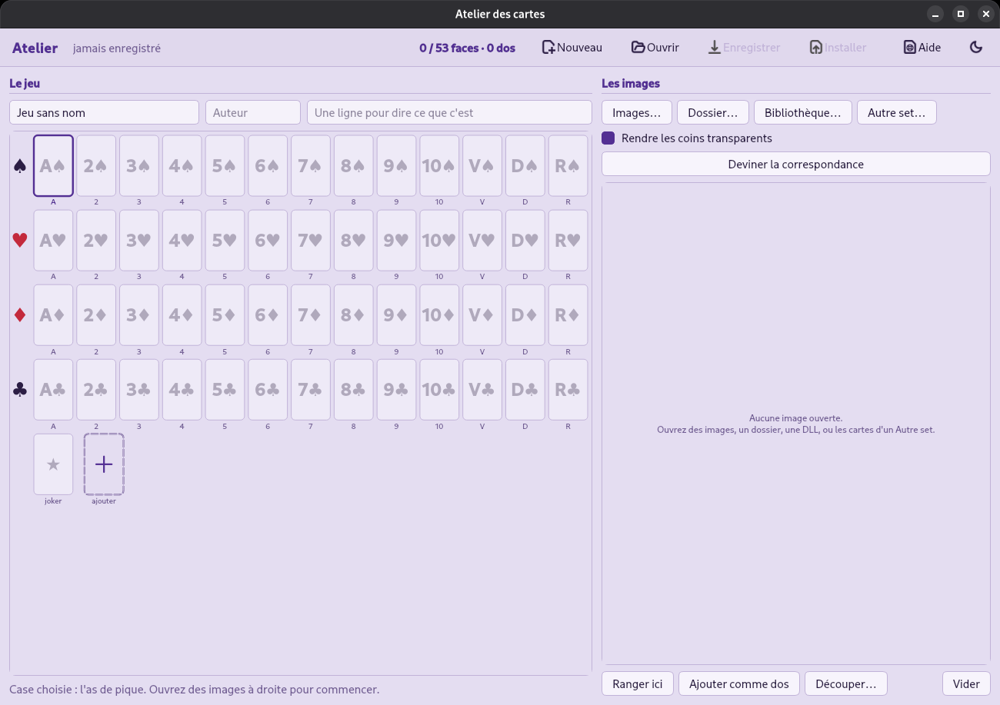

# L'atelier des cartes

Un programme pour fabriquer des jeux de cartes, écrit en C++17 avec Qt 6. On
lui donne des images, ou une DLL Windows dont on extrait les images, on place
les faces et les dos dans une grille, et il produit **un seul fichier** à
copier dans le dossier des cartes. Les programmes de jeu qui lisent ce format
le proposent alors dans leurs réglages : rien à installer, aucune bibliothèque
à charger.



## Les deux moitiés du projet

| | |
|---|---|
| `lib/` | la bibliothèque `cartotheque` : le format de fichier, la liste des jeux installés, et le style commun aux programmes |
| `src/` | l'atelier : le programme qui écrit les fichiers que la bibliothèque relit |

`cartotheque` est une **bibliothèque statique** : elle est liée dans le binaire
du programme qui l'emploie, qui reste donc un exécutable seul, sans rien
d'installé à côté.

Un programme voisin s'en sert ainsi :

```cmake
add_subdirectory(../pdcartes-barquette/lib cartotheque)
target_link_libraries(monjeu PRIVATE cartotheque)
```

Les en-têtes s'incluent par leur nom seul : `#include "CardSet.h"`,
`#include "Palette.h"`.

## Le format

Un jeu de cartes est **un fichier** d'extension `.cartes`. Il contient les
cinquante-deux faces, le joker, autant de dos qu'on veut, et le nom de
l'auteur. Il se copie et s'échange comme n'importe quel fichier.

```
« CARTES »       6 octets, pour reconnaître le fichier
quint16          la version du format
QByteArray       tout le reste, compressé
```

Le reste est un `QDataStream` : le nom, l'auteur, la note, la taille de
référence d'une face, puis les faces (rang, couleur, type d'image, octets) et
les dos (nom, type d'image, octets). Les images sont conservées **telles
quelles** : un PNG reste un PNG, un SVG reste un SVG.

La **taille de référence** est celle que partagent la plupart des faces. Elle
est recalculée à chaque ajout d'image et à chaque ouverture de fichier. C'est
elle qui donne aux programmes de jeu la proportion des cartes à afficher : un
jeu qui déclare une taille presque carrée produit un affichage de cartes
presque carrées, même si ses images sont bien des cartes. Comme elle est
mesurée sur l'ensemble des faces, une planche placée un instant dans une case
puis retirée ne laisse pas sa proportion derrière elle, et un fichier écrit par
une version plus ancienne de l'atelier se corrige à la simple ouverture.

Les rangs vont de 1 (l'as) à 13 (le roi), et valent zéro pour le joker. Les
couleurs vont de 0 à 3, dans l'ordre pique, cœur, carreau, trèfle. Chaque
programme convertit sa propre numérotation à la lecture : un jeu où l'as est la
carte la plus forte peut le compter 14 chez lui, le format n'a pas à connaître
les règles.

## Le dossier des cartes

`~/.config/cartes`, **commun** à tous les programmes qui lisent ce format : un
fichier copié là est disponible dans tous, sans avoir à le copier plusieurs
fois. Chaque programme garde de son côté lequel il a choisi, de sorte qu'on
peut jouer à deux jeux différents avec deux jeux de cartes différents.

Le bouton **Installer** fait la copie.

## Fabriquer un jeu

Les cases du jeu à gauche, les images ouvertes à droite.

| | |
|---|---|
| **Images…** | ouvre des fichiers un par un : PNG, SVG, BMP, JPEG, GIF |
| **Dossier…** | ouvre toutes les images d'un dossier |
| **Bibliothèque…** | extrait les images d'une DLL Windows |
| **Autre set…** | ouvre les cartes d'un `.cartes` existant, pour en reprendre |
| clic sur une case | la sélectionne |
| clic sur une image | la sélectionne |
| clic droit sur une image | la colle à l'image sélectionnée, d'un côté ou de l'autre |
| **Ranger ici**, ou double-clic | place l'image sélectionnée dans la case sélectionnée |
| **Découper…** | découpe une planche de plusieurs cartes en morceaux d'une taille donnée |
| **Marges** | retire le cadre d'une planche avant de la quadriller |
| clic droit sur une case | la vide |
| `←` `→` | passer à la case précédente ou suivante |
| `Ctrl+S` / `Ctrl+O` | enregistrer / ouvrir |
| `F1` | l'aide, qui reprend tout ceci dans la fenêtre |

Après chaque placement, la sélection **avance automatiquement** à la case vide
suivante, et les images déjà placées portent une pastille : placer
cinquante-trois images demande peu d'attention.

Les dos sont au bout de la dernière rangée, après le joker. La case **+** en
ajoute un.

**Autre set…** ouvre les faces et les dos d'un jeu existant dans la liste des
images, sans toucher au jeu en cours : on peut ainsi reprendre deux figures
d'un jeu et les dos d'un autre. Ces images connaissent la case qu'elles
occupaient, et **Deviner la correspondance** les y replace toutes.

Il n'est pas nécessaire de tout remplir : un jeu qui n'a que ses figures
s'installe comme un autre, car **les programmes de jeu dessinent eux-mêmes les
cartes manquantes**.

## Les DLL Windows

Certaines DLL contiennent des images de cartes.

| | |
|---|---|
| NE | bibliothèques 16 bits |
| PE32 | 32 bits |
| PE32+ | 64 bits |

Les bitmaps sont extraits avec les quatorze octets d'en-tête que Windows ne
stocke pas avec eux ; les PNG et les JPEG des bibliothèques récentes sont
extraits tels quels. Les ressources contenues dans une archive — les
bibliothèques de Windows 7 rangent leurs images dans des fichiers `.cab` — ne
peuvent pas être extraites, et l'atelier indique combien de ressources il a
ignorées.

**Deviner la correspondance** applique l'ordre habituel de ces
bibliothèques : les ressources 1 à 52 pour les cartes, couleur par couleur de
l'as au roi, et 53 à 64 pour les douze dos. L'atelier demande ensuite de
vérifier la grille, car l'ordre des couleurs a changé d'une version de Windows
à l'autre.

**Rendre les coins transparents** efface la couleur de fond autour des coins
arrondis. L'effacement part des quatre coins et se propage de pixel en pixel
tant que la couleur ne change pas. Il ne supprime pas tous les pixels de cette
couleur : le blanc du coin est souvent aussi celui du milieu de la carte.

## Les planches

Les jeux de cartes récents ne contiennent plus une image par carte : ils en
placent cinquante-deux, ou cent quarante, sur **une seule image** en rangées et
en colonnes. Le `CardGames.dll` de Windows 7 ne contient que des planches.

**Découper…** découpe l'image sélectionnée. On indique la **taille d'un
morceau** — largeur et hauteur en pixels — et le découpage se dessine sur
l'image à mesure qu'on saisit les valeurs : des traits qui ne tombent pas entre
les cartes signalent une taille incorrecte avant tout découpage. **Rogner les
bords** retire quelques pixels tout autour de chaque morceau, de quoi supprimer
le trait qui sépare les cartes.

Une taille plutôt qu'un nombre de colonnes, afin que les morceaux fassent
**tous exactement cette taille**. Un nombre de colonnes divise la planche en
parts égales, et des parts égales tombent entre deux pixels dès que la largeur
de la planche n'est pas un multiple du nombre de colonnes : les cartes sortent
alors décalées d'un pixel les unes par rapport aux autres, et ce décalage ne se
corrige plus. Ce qui reste au bord forme un dernier morceau plus petit,
dessiné en pointillé, jamais agrandi, et annoncé sous les champs : il s'agit
presque toujours d'une marge qu'on n'avait pas remarquée.

L'aperçu permet de regarder le détail : la **molette** agrandit sous le
curseur, on **déplace** la planche en la tirant, et le **double-clic** la
réaffiche en entier. Une planche de cinquante-deux cartes tient dans la boîte,
où un trait de découpe qui passe à deux pixels d'une carte est invisible.

Les quatre **marges** sont retirées de la planche *avant* le quadrillage, et
c'est tout leur intérêt : ce qui n'est pas une carte — un cadre, un filet, la
rangée coupée en deux en bas d'un quart de planche — est exclu du calcul, au
lieu de décaler toutes les cartes de sa largeur. Une bordure laissée dans le
quadrillage ne se corrige pas après coup ; le rognage, qui s'applique à chaque
morceau, n'y change rien.

Une marge peut être **négative** : le quadrillage dépasse alors la planche de
ce côté. Les planches ne sont pas toutes bien alignées — il manque trois pixels
à gauche, la première rangée commence avant le bord — et une marge négative
réaligne le quadrillage au lieu de décaler toutes les cartes. La partie qui
dépasse de la planche sort **transparente** : le morceau du bord garde sa
taille, et seules la première ou la dernière rangée sont incomplètes. Ce que
les marges excluent est grisé sur l'aperçu, afin de voir ce qui sera retiré.

Exemple : les planches en double résolution que les bibliothèques découpent en
quatre. Le quart de 1019 × 1024 contient six colonnes et cinq rangées entières
de cartes de 146 × 196, et le reste — 143 pixels à droite, 44 en bas — est la
moitié des cartes voisines. Mis en marge, ou laissé aux morceaux en pointillé
qu'on ne placera pas, les trente cartes entières sortent correctement alignées.

La planche est retirée de la liste, ses morceaux prennent sa place dans l'ordre
de lecture, et il n'y a plus qu'à les placer.

## Recoller les quarts d'une planche

Les bibliothèques stockent leurs planches en **double résolution** découpées en
quatre quarts, parce qu'un bitmap de deux mille pixels de côté n'était pas
partout accepté. Un quart se découpe mal : ses bords traversent des cartes.

Le **clic droit** sur une image propose de la coller à l'image
sélectionnée — à gauche, à droite, au-dessus ou au-dessous. Les deux images
sont alignées sur le bord qu'elles partagent, et ce qui manque à la plus courte
reste transparent : rien n'est étiré. L'image obtenue remplace l'image
sélectionnée et reste sélectionnée, de sorte que les collages s'enchaînent.

Les quatre quarts du `CardGames.dll` de Windows 7 se recomposent en trois
collages :

| | |
|---|---|
| `…X21` + `…X22` **à droite** | 1024 × 1024 et 1019 × 1024 donnent le haut, 2043 × 1024 |
| `…X23` + `…X24` **à droite** | le bas, 2043 × 935 |
| le bas **au-dessous** du haut | la planche entière, 2043 × 1959 |

Elle se découpe ensuite en 14 × 10 comme n'importe quelle autre, en cartes de
146 × 196 — quatre fois la surface des 73 × 98 de la petite planche. Les quarts
sont retirés de la liste à mesure qu'ils sont recollés.

Deux mille quarante-trois pixels ne font pas quatorze colonnes entières : les
morceaux sortent à un pixel près les uns des autres, ce qui est sans
conséquence, puisque la taille de référence du jeu est celle que partage la
majorité des morceaux et que les programmes de jeu affichent les cartes à la
taille qu'ils veulent.

## Partir d'un jeu existant

Le plus simple, pour commencer, est de partir d'un jeu déjà complet : un
programme de jeu qui sait exporter son jeu dessiné en `.cartes`, ou n'importe
quel `.cartes` installé.

```sh
pdcartes-barquette mon-jeu.cartes
```

On remplace les cartes qu'on veut, on enregistre, on installe.

## Construire

```sh
cmake -S . -B build
cmake --build build
./build/pdcartes-barquette
```

Pour un paquet Debian : `cmake --build build --target deb`. Son nom porte
l'heure du build derrière un `~` —
`pdcartes-barquette_1.0.0~261024225112_amd64.deb` — ce qui le classe *avant* la
version qu'il prépare, et permet donc à celle-ci de le remplacer.

Pour le paquet d'une version, nommé par son numéro seul et sans empreinte à
l'intérieur : `cmake --build build --target release`.

Le greffon Qt qui lit les SVG (`qt6-svg-plugins`) n'est pas une dépendance
obligatoire — un jeu en PNG fonctionne sans — mais sans lui un jeu vectoriel
s'affiche en cartes blanches.

## Le code

| | |
|---|---|
| `lib/CardSet.cpp` | le format : écrire, relire, et rendre une face à la taille demandée |
| `lib/CardDeck.cpp` | les jeux installés, celui qui est choisi, le dos choisi |
| `lib/DllResources.cpp` | la lecture des bibliothèques Windows, NE et PE |
| `lib/Palette.cpp` | toutes les couleurs, dérivées d'une seule teinte |
| `lib/DialogChrome.cpp` | l'habillage commun aux boîtes de dialogue |
| `src/FaceGrid.cpp` | les cases d'un jeu : quatre rangées de treize, le joker, les dos |
| `src/SourceTray.cpp` | la liste des images ouvertes |
| `src/SplitDialog.cpp` | le découpage d'une planche en morceaux |
| `src/AtelierWindow.cpp` | la fenêtre, et les échanges entre les deux zones |
| `src/HelpDialog.cpp` | le mode d'emploi complet, affiché dans la fenêtre |
